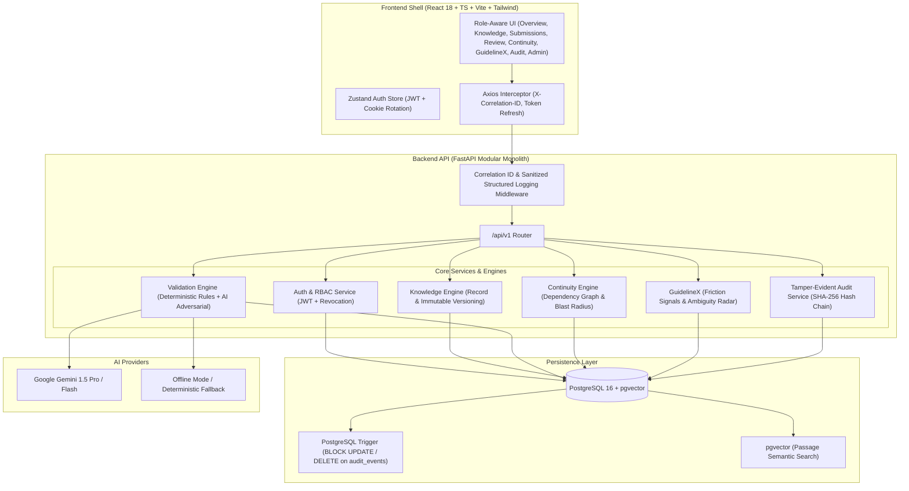

# BRIDGE Architecture

BRIDGE (Brand Rules, Intelligence, Dependency, Governance & Evidence) is an enterprise brand governance and continuous brand compliance platform. It bridges normative brand guidelines, product specifications, and legal rules with downstream digital asset creation.

## System Components

1. **Frontend (`frontend/` or `web/`)**:
   - Single Page Application built with React 18, TypeScript, Tailwind CSS, and Vite.
   - Real-time React Flow interactive dependency topology.
   - Role-aware routing and navigation for 5 enterprise personas.
   - Offline-aware AI status badge in TopBar.

2. **Backend API (`backend/` or `api/`)**:
   - High-throughput asynchronous FastAPI monolith.
   - Pydantic v2 schemas with standardized error envelopes.
   - Startup environment validation ensuring graceful offline AI degradation.
   - Structured JSON logging with `X-Correlation-ID` tracing across all requests.
   - Sanitizer preventing credential or document payload leakage.

3. **Database & Storage (`db`)**:
   - PostgreSQL 16 with `pgvector` and `pgcrypto` extensions enabled.
   - Strict tenant isolation enforced on every query (`org_id`).
   - Append-only audit table protected by PostgreSQL triggers blocking UPDATE and DELETE statements.
   - Partial unique index enforcing exactly one active approved version per knowledge record.

