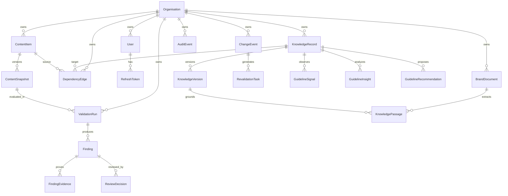

# BRIDGE Data Model & Invariants

This document specifies the data model, entity relationships, and database invariants for BRIDGE v2.



## Core Invariants

1. **UUID Primary Keys**: Every table uses a `uuid.UUID` primary key (`DEFAULT gen_random_uuid()`).
2. **UTC Timestamps**: All timestamp columns are timezone-aware (`DateTime(timezone=True)`) and default to `now(timezone.utc)`.
3. **Strict Multi-Tenancy**: All core business entities carry an indexed `org_id` foreign key referencing `organisations.id` with `CASCADE` delete.
4. **Single Current Approved Version**:
   - `knowledge_versions` contains a partial unique index:
   ```sql
   CREATE UNIQUE INDEX uq_one_approved_version_per_record 
   ON knowledge_versions (record_id) 
   WHERE status = 'approved';
   ```
   This guarantees at the database engine level that no record can ever have two simultaneous approved versions.
5. **Append-Only Tamper-Evident Audit Ledger**:
   - `audit_events` rows are linked cryptographically via `prev_hash` -> `event_hash = SHA256(canonical_json(event))`.
   - A PostgreSQL trigger prohibits `UPDATE` and `DELETE` operations on `audit_events`.
6. **Immutable Snapshots**:
   - `ContentSnapshot` and `KnowledgeVersion` rows are immutable once created. Any amendment generates a new incremented version number.

## Entity Catalog

### 1. Organisation & User Management
- **Organisation**: Root multi-tenant boundary (`id`, `name`, `slug`, `settings_json`, `created_at`, `updated_at`).
- **User**: Member identity (`id`, `org_id`, `email`, `hashed_password`, `role`, `is_active`, `full_name`).
- **RefreshToken**: Rotatable auth tokens with hash verification and revocation (`id`, `user_id`, `token_hash`, `expires_at`, `revoked_at`, `revoked_by`).

### 2. Knowledge & Brand Governance
- **BrandDocument**: Authoritative document sources e.g. PDF guidelines, web policies (`id`, `org_id`, `name`, `source_type`, `description`, `is_active`, `current_version_id`).
- **KnowledgeRecord**: Governed business entity with stable identifier such as `F-014` (`id`, `org_id`, `stable_identifier`, `source_id`, `kind`, `title`, `current_version_id`).
  - `kind` enum: `fact`, `claim`, `rule`, `guideline`, `asset`.
- **KnowledgeVersion**: Immutable version of a record (`id`, `record_id`, `version_number`, `status`, `value`, `effective_date`, `owner_id`, `provenance`, `created_by`, `approved_by`, `rule_config_json`).
  - `status` enum: `draft`, `pending_verification`, `approved`, `superseded`, `rejected`.
- **KnowledgePassage**: Authoritative chunk extracted from documents for exact citation grounding (`id`, `org_id`, `source_id`, `version_id`, `passage_index`, `text`, `char_start`, `char_end`, `vector`).

### 3. Content Validation & Evidence Receipts
- **ContentItem**: Monitored digital asset (`id`, `org_id`, `title`, `content_identifier`, `channel`, `created_by`).
- **ContentSnapshot**: Immutable version of submitted content (`id`, `content_id`, `snapshot_version`, `raw_text`, `checksum_sha256`).
- **ValidationRun**: An execution of deterministic + AI validation (`id`, `org_id`, `snapshot_id`, `status`, `ai_provider_used`, `rule_set_version`, `completed_at`, `error_message`).
- **Finding**: Detected violation, claim or tone breach (`id`, `run_id`, `org_id`, `finding_type`, `severity`, `description`, `is_evidence_backed`, `status`).
- **FindingEvidence**: Exact quote citations and cryptographic evidence receipts (`id`, `finding_id`, `version_id`, `passage_id`, `exact_quote`, `receipt_json`).
- **ReviewDecision**: Human reviewer override or approval (`id`, `finding_id`, `decided_by`, `decision`, `reason_code`, `justification`).

### 4. Continuity & Impact
- **DependencyEdge**: Graph edge between content and knowledge records (`id`, `org_id`, `content_identifier`, `record_id`, `edge_type: confirmed | possible`, `confirmed_by`, `notes`).
- **ChangeEvent**: Modification of an authoritative source or rule (`id`, `org_id`, `source_id`, `old_version_id`, `new_version_id`, `change_summary`).
- **ImpactReport**: Calculated blast radius of a change (`id`, `change_event_id`, `affected_content_count`, `blast_radius_score`, `report_json`).
- **RevalidationTask**: Work item to re-verify an impacted asset (`id`, `impact_report_id`, `org_id`, `content_identifier`, `priority`, `exposure_score`, `status`).

### 5. GuidelineX Intelligence
- **GuidelineSignal**: Observed friction signal from overrides or feedback (`id`, `org_id`, `record_id`, `source_type`, `signal_text`, `severity`).
- **GuidelineInsight**: Synthesized ambiguity radar analysis (`id`, `org_id`, `record_id`, `trigger_signal_count`, `analysis_summary`, `ambiguous_aspects_json`, `confidence_score`).
- **GuidelineRecommendation**: Normative update proposal (`id`, `org_id`, `record_id`, `insight_id`, `proposed_content`, `rationale`, `status`).

### 6. System & Audit
- **Job**: Async background job queue (`id`, `org_id`, `job_type`, `status`, `payload`, `attempts`, `error`).
- **AuditEvent**: Tamper-evident ledger row (`id`, `org_id`, `event_type`, `actor_id`, `actor_email`, `resource_type`, `resource_id`, `diff_json`, `prev_hash`, `event_hash`, `created_at`).

